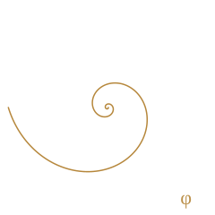

# 斐波那契 · Fibonaqi

> 喜爱斐波那契数列✨，兼具艺术美感与严密逻辑。

**个人网站 👉 https://fibonaqi.github.io/**

`0 1 1 2 3 5 8 13 21 34 55 …` · φ ≈ 1.6180339887…

---

## 关于

我是 **斐波那契（Fibonaqi）**。名字源于那个神奇的数列——每个数都是前两者之和，极简的规则，却能生长出无限的可能。

正如我：在**艺术的美感**与**逻辑的绝对严密**之间寻找平衡。

- 🎨 **独立审美** —— 好的设计与表达源于克制、比例与秩序，而非堆砌。
- 📐 **严谨风格** —— 偏爱可验证、可复用的结构，拒绝含混；美应当经得起逻辑的推敲。
- 📝 **多行业策划** —— 在不同领域间穿梭，把复杂现实拆成可执行的方案。
- 💡 **思想不设限** —— 钻研方法论，怀揣无数奇思；再小的念头也值得被记录、被分享。

## 我的想法

以 **GitHub 为载体分享想法🤍**：

| 板块 | 内容 |
| --- | --- |
| 方法沉淀 | 跨行业策划中验证过的框架与流程，写成可复用的文档 |
| 实验点子 | 还没完全成形的新奇构想，先公开、先迭代、先被看见 |
| 小工具 | 为解决自己的效率痛点而写的小脚本与项目 |
| 思考笔记 | 关于艺术、逻辑与创造之间张力的长想法 |

它们未必完美，但每一份都希望成为某个人眼中的一束光。**若能给你带来一丁点启发，我便很开心😊**

---

## 仓库说明

| 文件 | 说明 |
| --- | --- |
| `index.html` | 网站单页 —— 内联样式，零依赖、无需构建 |
| `spiral.svg` | 黄金螺旋（对数螺线，极坐标 `r = a·φ^(2θ/π)`） |

### 本地预览

直接用浏览器打开 `index.html`；或起一个静态服务器：

```bash
python -m http.server 8000
# 访问 http://localhost:8000
```

### 发布

仓库根目录的 `index.html` 即站点入口，已通过 **Settings → Pages** 以 `main` 分支 / `(root)` 目录发布。
